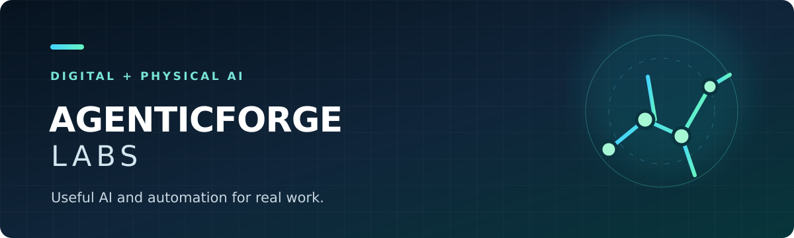

  

  <strong>Making AI useful in the physical world—and in the everyday work of small teams.</strong>

  <a href="https://agenticforgelabs.com/">Website</a> &nbsp;·&nbsp;
  <a href="https://phenotyper.com/">Phenotyper</a> &nbsp;·&nbsp;
  <a href="https://agenticforge.studio/">AgenticForge Studio</a> &nbsp;·&nbsp;
  <a href="mailto:info@agenticforgelabs.com">Get in touch</a>

---

## AI, robotics, and automation that do real work

**AgenticForge Labs** brings digital and physical AI together to build practical, multimodal agentic systems. We're interested in the useful middle ground between a promising demo and a system that can reliably help someone get work done.

For small businesses, that might mean automating a repetitive software workflow, adding cameras and robot arms to a production process, or making short-run fabrication more autonomous. For scientists, it might mean more accessible imaging instruments and laboratory automation.

**Start with a real task. Automate what works. Keep people in control.**

<table>
  <tr>
    <td width="50%" valign="top">
      <h3>🏭 Small-business automation</h3>
      
Agentic AI, integration, training, and practical robotics for the recurring tasks that take time away from running and growing a business.

    </td>
    <td width="50%" valign="top">
      <h3>🤖 Physical AI &amp; fabrication</h3>
      
Robot control, computer vision, 3D-printing workflows, and experiments in affordable machine tending, sorting, and handling.

    </td>
  </tr>
  <tr>
    <td width="50%" valign="top">
      <h3>🔬 Scientific instruments</h3>
      
Through <a href="https://phenotyper.com/">Phenotyper</a>, we develop practical imaging, phenotyping, and automation tools for laboratories and researchers.

    </td>
    <td width="50%" valign="top">
      <h3>🎬 Creative agentic systems</h3>
      
Voice, expression, generative media, and the tools that connect digital characters and creative workflows to physical devices.

    </td>
  </tr>
</table>

---

## Featured public repositories

These are our publicly available projects. Each repository has its own documentation, development status, and licensing terms.

<table>
  <tr>
    <td width="50%" valign="top">
      
      <h3><a href="https://github.com/AgenticForge-Labs/forge-puppeteer">Forge Puppeteer</a></h3>
      
An MCP interface for agent interaction with supported robots, with shared gestures, expressions, and scripted performances.

    </td>
    <td width="50%" valign="top">
      
      <h3><a href="https://github.com/AgenticForge-Labs/soarm101-motion-sdk">SO-ARM101 Motion SDK</a></h3>
      
A Python-first toolkit for calibration, motion control, teach-and-repeat workflows, simulation, and guarded robot operation.

    </td>
  </tr>
  <tr>
    <td width="50%" valign="top">
      
      <h3><a href="https://github.com/AgenticForge-Labs/forge-conversationalist">Forge Conversationalist</a></h3>
      
Real-time voice agents for browser or local audio, with an optional connection to robots through Forge Puppeteer.

    </td>
    <td width="50%" valign="top">
      
      <h3><a href="https://github.com/AgenticForge-Labs/stackchan-control-sdk">StackChan Control SDK</a></h3>
      
Host-side Python tools and device interfaces for motion, facial expression, lights, and testing without hardware.

    </td>
  </tr>
</table>

<table>
  <tr>
    <td width="50%" valign="top">
      <h3>🧪 <a href="https://github.com/AgenticForge-Labs/forge-bench">Forge Bench</a></h3>
      
Reproducible experimental designs and trace-based analysis for evaluating AI agents, models, and coding workflows.

    </td>
    <td width="50%" valign="top">
      <h3>🎞️ <a href="https://github.com/AgenticForge-Labs/forge-studios">Forge Studios</a></h3>
      
Structured generated-media execution, storyboard workflows, review, assembly, and production telemetry.

    </td>
  </tr>
</table>

  <a href="https://github.com/AgenticForge-Labs?tab=repositories"><strong>Browse all public repositories</strong></a>

---

## Work with us

Have a repetitive workflow that could benefit from an AI agent, a camera, a robot, or a combination of all three? We work on prototypes, integration, applied research, consulting, and training—remotely and on-site.

  <a href="https://agenticforgelabs.com/"><strong>Explore AgenticForge Labs</strong></a> &nbsp;·&nbsp;
  <a href="https://phenotyper.com/"><strong>Explore Phenotyper</strong></a> &nbsp;·&nbsp;
  <a href="mailto:info@agenticforgelabs.com"><strong>Contact us</strong></a>

AgenticForge Labs · Tennessee, USA · Digital + physical AI

